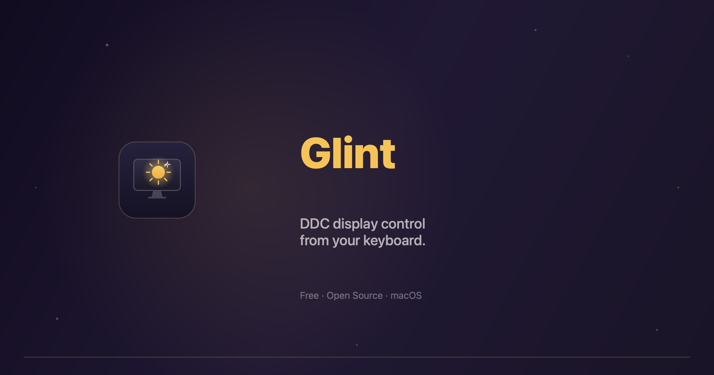

# ✨ Glint

**DDC display control from your keyboard. Tiny, invisible, always ready.**

<p align="center">
  
</p>

Glint intercepts your Mac's brightness and volume media keys and sends [DDC/CI](https://en.wikipedia.org/wiki/Display_Data_Channel) commands to your external monitor — so the keys that normally only control your MacBook screen now also control your monitor's **actual hardware brightness** and **built-in speakers**.

> 🪶 **Under 1 MB.** No Electron. No frameworks. Pure Swift + IOKit.
> Zero CPU when idle. Disappears completely if you want it to.

---

## 🎯 Why Glint Exists

If you've ever plugged an external monitor into your Mac, you know the pain:

- **Brightness keys?** Only control the MacBook screen.
- **Volume keys?** Only control the Mac speakers — not the monitor's.
- **The fix?** Reach for clunky OSD buttons on the back of your monitor. Every. Single. Time.

Glint makes your keyboard Just Work™ with external displays.

---

## ⚡ Features

| Feature | Details |
|---------|---------|
| 🔆 **Brightness keys** | Controls your external display's backlight via DDC — not software gamma |
| 🔊 **Volume keys** | Adjusts volume via DDC when audio output is HDMI/DisplayPort/USB-C (including hubs), or system volume for built-in speakers/headphones/Bluetooth |
| 🔇 **Mute key** | Toggles mute with a proper muted/unmuted OSD indicator |
| 🎯 **Cursor-aware** | Brightness keys adjust only the display the cursor is on — no more changing every screen at once |
| 🔄 **Sync mode** | First keypress syncs all displays to match the cursor display's brightness, then adjusts every screen in lockstep |
| 🎚️ **Adjustable step** | Choose how much each key press changes brightness and volume — 1% to 10% (default 6.25%, matching macOS) |
| 🖥️ **Subtle OSD** | Shows a minimal pill-style brightness/volume overlay below the notch |
| 👻 **Invisible mode** | Hide from menu bar AND dock — completely invisible, always listening |
| 🚀 **Launch at login** | Starts silently, ready before you are |
| 🪶 **Tiny footprint** | < 1 MB, zero dependencies, negligible CPU/memory |
| 🆓 **Free & open source** | MIT License. No telemetry. No accounts. No nonsense. |

---

## 📦 Install

### Homebrew

```bash
brew install --cask blaineam/tap/glint
```

### Download

Grab the latest **notarized DMG** from [Releases](../../releases) — drag to Applications, done.

Requires **macOS 13 Ventura or later on Apple silicon**. Glint builds are
arm64-only (Apple's September 2026 guidance lets apps that require macOS 13+
drop Intel, and macOS 27 runs only on Apple silicon); Intel Macs should stay on
v1.4.3.

### Windows 10 / 11 (preview, no admin needed)

Download `Glint-windows-x64.exe` (or `Glint-windows-arm64.exe` for Snapdragon/ARM PCs) from [Releases](../../releases), put it anywhere (for example `%LOCALAPPDATA%\Programs\Glint`) and run it. There is no installer and nothing needs admin rights. The exe isn't code-signed yet, so SmartScreen may ask: choose **More info → Run anyway**.

Glint for Windows lives in the tray and has the Mac app's controls:

- **Brightness:** keyboards with brightness keys (Mac-layout keyboards from Logitech, Keychron and others) work directly: Glint reads their HID brightness codes, which Windows otherwise ignores. Every keyboard also gets hotkeys: **Ctrl+Alt+Page Down / Page Up** by default, or Ctrl+Alt+F1/F2, plain F1/F2 (an Apple keyboard without Boot Camp drivers sends F1/F2 from its brightness keys) or F14/F15. The display under the cursor changes. Laptop panels are controlled too, through WMI.
- **HDR displays:** monitors lock their backlight in HDR mode, so for a display Windows drives in HDR, Glint adjusts Windows' *SDR content brightness* instead (the slider in Settings › Display › HDR): desktop and app content gets brighter or dimmer; HDR video and games aren't affected. Turning HDR off switches back to the backlight on the next key press. The flyout labels it *Brightness (HDR)*.
- **Volume:** when Windows plays through a monitor (HDMI, DisplayPort, USB-C), the volume and mute keys drive that monitor's speakers over DDC. Otherwise Windows handles them.
- **Sync all displays and Windows volume** (on by default, like the Mac's *Sync with built-in display*): brightness keys move every display to the cursor display's level, and volume keys move Windows' volume and every monitor's speakers together.
- **Click the tray icon** for brightness and volume sliders per display. **Right-click** for settings: *Keyboard Controls* (intercept brightness/volume keys, always intercept, write-only volume, hotkeys, step sizes 1–10% with 6.25% default), on-screen indicator, launch at login, hide the tray icon (open Glint again to bring it back), rescan displays and *Diagnostics* (debug logging, log folder).
- In the same 9 languages as the Mac app, following the Windows display language.

If your keyboard's brightness keys also bring up Windows' own brightness indicator, switch the keyboard's Fn-lock so the top row sends F1/F2 and pick *F1 / F2* as the brightness hotkeys: Windows then never sees a brightness key. Windows has no setting to hide its indicator.

Settings live in `HKCU\Software\wemiller\Glint`; launch at login uses your per-user Run key. Known limits: keys aren't caught while an app running as administrator is focused (Windows doesn't let standard-user hooks see those), and some KVMs and docks don't pass DDC/CI through.

Build it yourself with Rust: `cd windows && cargo build --release`.

### Linux (experimental)

> ⚠️ **Glint for Linux is experimental and hasn't been tested on real monitors yet.** It builds and passes its tests on every supported architecture, and CI runs it on Rocky Linux 8, Ubuntu, Arch and Debian ARM, but nobody has driven a real monitor with it. Use with caution, and please [open an issue](../../issues) with the output of `glint status` if something doesn't work.

Glint for Linux targets **Rocky Linux / RHEL 8+, Ubuntu, Raspberry Pi OS and SteamOS**, and runs on any systemd distribution (Debian, Fedora, Arch, openSUSE, Mint, Pop!_OS…). It's one static binary per architecture, so it doesn't depend on your distribution's library versions: x86_64, ARM64 (Raspberry Pi 4/5 with 64-bit OS, ARM laptops) and ARMv7 (32-bit Raspberry Pi OS).

| You have | Download from [Releases](../../releases) | Install |
|---|---|---|
| Ubuntu, Debian, Raspberry Pi OS, Mint | `glint_<version>_amd64.deb` / `_arm64.deb` / `_armhf.deb` | `sudo apt install ./glint_*.deb` |
| Rocky, RHEL, Alma, Fedora, openSUSE | `glint-<version>-1.x86_64.rpm` / `.aarch64.rpm` | `sudo dnf install ./glint-*.rpm` |
| SteamOS, Arch, anything else | `glint-linux-x86_64.tar.gz` (or `aarch64` / `armv7`) | extract, then `./install.sh` |

Then open **Glint** from your app menu (or run `glint`) and turn on *Launch at login* in its tray menu. The packages do the one-time system setup for you; with the tarball, `install.sh` runs it (`sudo glint setup`). On SteamOS, set a password first with `passwd` in Konsole; Glint then works in Desktop Mode and in Game Mode.

**What the one-time setup does, and why:** Linux only lets regular users talk to I²C buses (where DDC/CI lives) and read keyboards after a udev rule allows it. Glint's rule gives *the user sitting at the computer* (systemd's `uaccess`, the same mechanism that hands you the sound card and webcam) access to `/dev/i2c-*`, `/dev/uinput` and keyboard input devices, and loads the `i2c-dev` and `uinput` modules. Nothing is opened to other users or remote logins. `sudo glint setup --remove` undoes it.

How it works on Linux:

- **Keys** are read through evdev, so they work the same under X11, Wayland, SteamOS Game Mode and the console. Keyboards with brightness or volume keys are taken over and every other key is passed straight through a virtual keyboard, so Glint can *take* the volume keys when sound goes to a monitor instead of the desktop also changing its own volume. Mac-layout keyboards' brightness keys work; any keyboard can use Ctrl+Alt+Page Up / Page Down (or the other hotkey choices).
- **Monitors** are found through `/sys/class/drm` and their EDID; Glint speaks DDC/CI directly over the monitor's I²C bus (no ddcutil needed). With NVIDIA's proprietary driver, buses are matched to monitors by EDID.
- **Laptop and Steam Deck screens** are set through systemd-logind, as your desktop does.
- **Volume** follows the same rules as on Mac and Windows: monitor speakers over DDC when the sound goes to a monitor (HDMI/DisplayPort, named by the monitor's ELD), and with *Sync* on, the system volume (PipeWire or PulseAudio through `pactl`) and every monitor together.
- **Tray icon** (StatusNotifierItem) on KDE Plasma, SteamOS Desktop Mode, XFCE, Cinnamon, LXQt, Budgie, Ubuntu's GNOME and Raspberry Pi OS. On GNOME without the AppIndicator extension there's no icon, but keys still work and every setting is in `~/.config/glint/glint.conf`. The level indicator is a desktop notification.
- **Command line:** `glint status` shows what Glint found and can control; `glint brightness up|down|0-100` and `glint volume up|down|mute|0-100` work with a running Glint, handy for desktop shortcuts.
- **Differences from Mac/Windows:** Wayland has no global cursor position, so brightness keys change every display (in sync mode, all to one level, the default) instead of only the one under the cursor; there are no sliders (SNI menus have 10% levels instead); HDR brightness isn't adjusted.

Build it yourself with Rust: `cd linux && cargo build --release`.

### Build from source

```bash
# Install xcodegen if you don't have it
brew install xcodegen

# Generate the Xcode project
xcodegen generate

# Build
xcodebuild -scheme Glint -configuration Release build
```

---

## ❤️ Support future development

Glint is free — no ads, no tracking, no subscription. If it earns a place on your Mac, you can help fund what comes next.

[**Sponsor on GitHub**](https://github.com/sponsors/blaineam) · [**Buy me a coffee on Ko-fi**](https://ko-fi.com/wemiller)

[All the ways to support →](https://wemiller.com/support/)

---

## 🛠️ Setup

1. **Open Glint** — it appears in your menu bar as a ☀️ icon
2. **Grant Accessibility access** when prompted (System Settings → Privacy & Security → Accessibility)
3. **Quit and relaunch Glint** after enabling Accessibility access
4. **Press your brightness/volume keys** — they now control your external display!

### Going invisible

Toggle **"Hide menu bar icon"** in Settings. Glint vanishes from the menu bar and dock entirely. To access settings again, just open Glint from your Applications folder — it'll show the settings window.

---

## 🔧 How It Works

```
┌──────────────┐    CGEventTap     ┌──────────────┐    IOKit I2C     ┌──────────────┐
│   Keyboard   │ ───────────────▶  │    Glint     │ ──────────────▶ │   Monitor    │
│  Media Keys  │   intercept key   │  (< 1 MB)    │   DDC/CI cmd    │  Hardware    │
└──────────────┘                   └──────────────┘                 └──────────────┘
                                         │
                                         │ (sync mode)
                                         ▼
                                   Programmatic control
                                   of built-in display
                                   brightness & system
                                   volume via IOKit/CoreAudio
```

1. **`CGEventTap`** intercepts and fully consumes media key events — no macOS OSD ever appears
2. **DDC/CI commands** are sent over the I2C bus (via `IOAVService` on Apple Silicon) to adjust hardware brightness/volume on external displays
3. **Cursor-aware**: when sync is off, only the display the cursor is on is adjusted — built-in or external
4. **Sync mode** (on by default): Glint programmatically adjusts the built-in display brightness (via IOKit) and system volume (via CoreAudio) alongside external monitors — all stay in lockstep
5. **First-keystroke sync**: when sync is enabled, the first key press reads the cursor display's current brightness and forces all other displays to match before adjusting together

### Why not the Mac App Store?

DDC requires direct I2C communication through IOKit, which is blocked by the App Store sandbox. This is why **every** DDC app (BetterDisplay, MonitorControl, Lunar) distributes outside the App Store. Glint is notarized by Apple for security — it's just not sandboxed.

---

## 🏗️ Project Structure

```
Glint/
├── Sources/
│   ├── App/
│   │   ├── GlintApp.swift              # SwiftUI entry point, menu bar setup
│   │   └── Glint-Bridging-Header.h     # IOKit I2C headers
│   ├── Services/
│   │   ├── DDCService.swift            # IOKit I2C DDC/CI communication
│   │   ├── DisplayManager.swift        # Display enumeration, brightness/volume control
│   │   ├── MediaKeyInterceptor.swift   # CGEventTap media key interception
│   │   ├── OSDOverlay.swift            # Native overlay HUD
│   │   └── Preferences.swift           # UserDefaults + launch-at-login
│   └── Views/
│       ├── MenuBarView.swift           # Popover with per-display sliders
│       └── SettingsView.swift          # Settings window
├── Resources/
│   ├── Assets.xcassets/                # App icon, accent color
│   ├── Info.plist
│   └── Glint.entitlements
├── Scripts/
│   ├── generate-assets.swift           # Programmatic icon + DMG background generator
│   ├── build-dmg.sh                    # Full build → sign → notarize → DMG pipeline
│   └── notarize.sh                     # Standalone notarization script
├── docs/                               # GitHub Pages site
├── project.yml                         # XcodeGen project spec
├── LICENSE                             # MIT
└── README.md
```

---

## 🤝 Contributing

Contributions welcome! Here's how to get started:

1. **Fork & clone** the repo
2. **Install xcodegen**: `brew install xcodegen`
3. **Generate the project**: `xcodegen generate`
4. **Open** `Glint.xcodeproj` in Xcode
5. **Build & run** — you'll need an external monitor with DDC support to test
6. **Run the tests** — the `Glint` scheme runs the unit tests (`GlintTests`); the
   `GlintUITests` scheme runs XCUITest against fixture monitors (DEBUG-only
   `-UITestMode`, see `Glint/Sources/App/UITestMode.swift`), so no monitor or
   Accessibility permission is needed. Debug builds use the bundle ID
   `com.blainemiller.Glint.debug` and never touch an installed Glint.

### Guidelines

- Keep it **tiny** — Glint's value is in its simplicity and small footprint
- No third-party dependencies — pure Swift + system frameworks
- Match the existing code style (no SwiftLint, just be consistent)
- Test with real hardware — DDC behavior varies across monitor brands
- Open an issue first for large changes so we can discuss the approach

### Reporting issues

If DDC doesn't work with your monitor:
1. Enable **Debug logging** in Settings
2. Try adjusting brightness/volume
3. Click **Show Log File** to find the log
4. Include the log along with your monitor make & model, connection type, macOS version, and whether other DDC apps work

---

## 📋 FAQ

<details>
<summary><strong>Does Glint work with my monitor?</strong></summary>

Most external monitors support DDC/CI. If your monitor has an OSD (on-screen display) with brightness/volume controls, it almost certainly supports DDC. Known exceptions: some older Apple displays and a few budget monitors with DDC disabled by default (check your monitor's OSD settings).
</details>

<details>
<summary><strong>Does it work over HDMI? DisplayPort? USB-C?</strong></summary>

Yes to all three. DDC/CI works over HDMI, DisplayPort, and USB-C/Thunderbolt — including through USB-C hubs and docks. Glint automatically detects monitor audio routed through hubs by matching the audio device name against connected displays.
</details>

<details>
<summary><strong>Why does Glint need Accessibility access?</strong></summary>

To intercept media key events (brightness, volume) before macOS processes them, Glint uses a `CGEventTap`, which requires Accessibility permission. Without it, Glint can't detect key presses.
</details>

<details>
<summary><strong>Is this safe? Why isn't it on the Mac App Store?</strong></summary>

Glint is open source (read every line!) and notarized by Apple (malware-scanned). It's not on the App Store because DDC requires IOKit I2C access, which the App Store sandbox blocks. This is the same reason BetterDisplay, MonitorControl, and Lunar are all distributed outside the store.
</details>

<details>
<summary><strong>How do I access settings after hiding the menu bar icon?</strong></summary>

Open Glint from your Applications folder (or Spotlight). When the app detects it's being re-opened, it shows the settings window automatically.
</details>

<details>
<summary><strong>Can I control multiple monitors?</strong></summary>

Yes! Glint detects all connected external displays. With sync mode off, brightness keys adjust only the display your cursor is on. With sync mode on, all displays (including the built-in screen) are adjusted together and synced to the same brightness on first key press.
</details>

<details>
<summary><strong>Does it conflict with BetterDisplay / MonitorControl / Lunar?</strong></summary>

Possibly — if two apps both intercept the same media keys, they may interfere. We recommend using one DDC controller at a time.
</details>

<details>
<summary><strong>What's the CPU/memory usage?</strong></summary>

Effectively zero when idle. Glint uses a `CGEventTap` which is interrupt-driven — no polling, no timers, no background threads. Memory footprint is under 15 MB.
</details>

---

## 📄 License

MIT License — see [LICENSE](LICENSE).

Free as in beer. Free as in speech. 🍺

---

<p align="center">
  <sub>Built with ☀️ by <a href="https://github.com/blaineam">Blaine Miller</a></sub>
</p>
